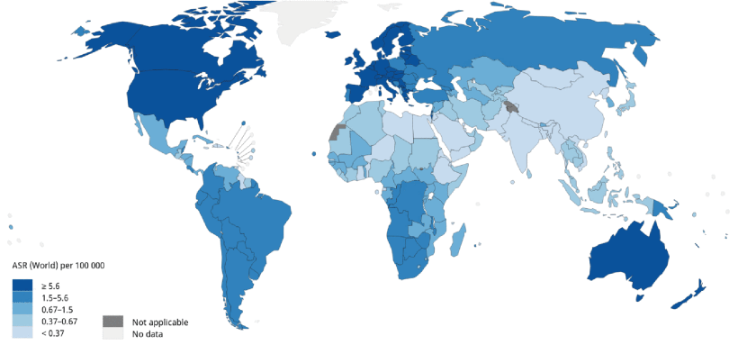
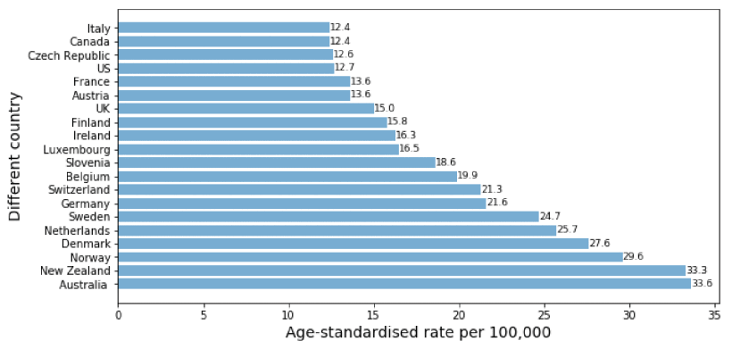
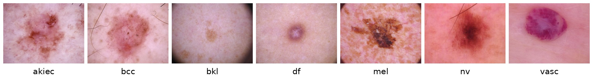
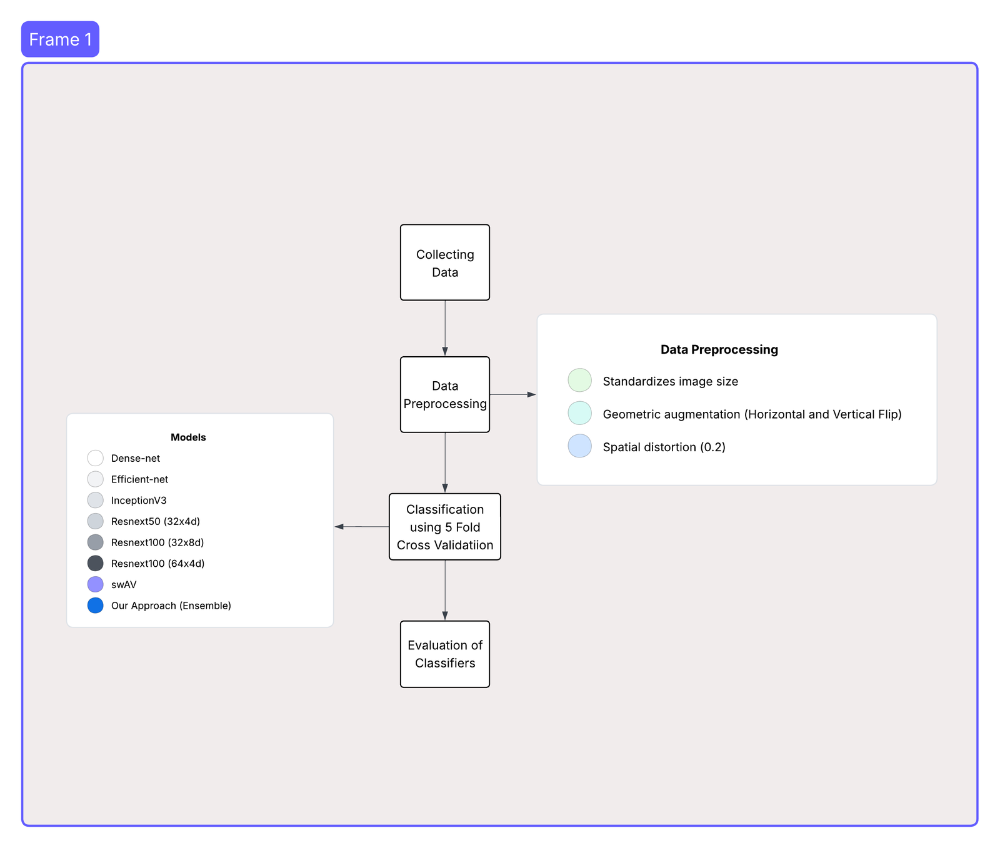
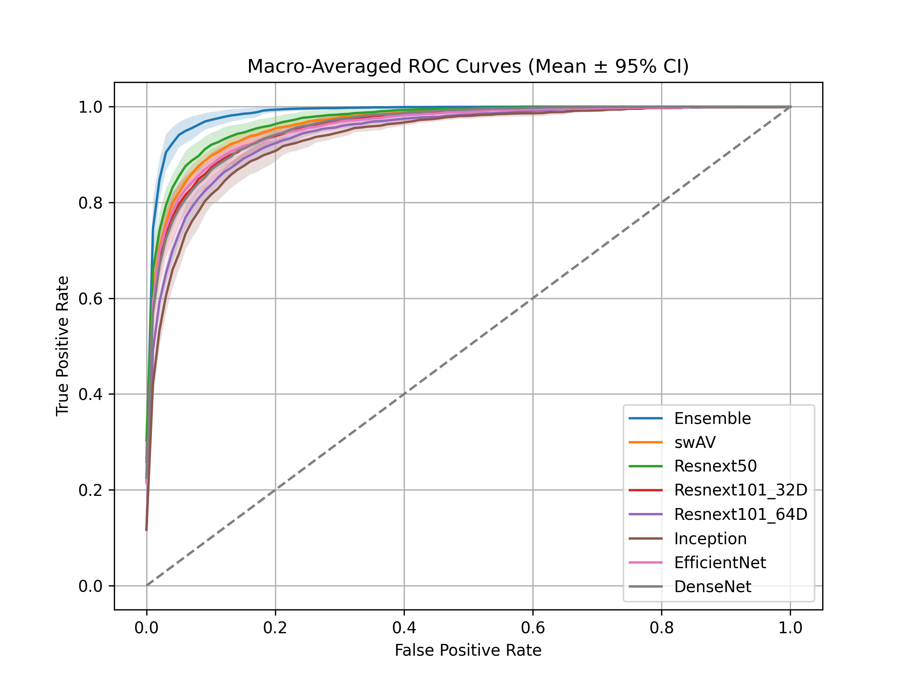
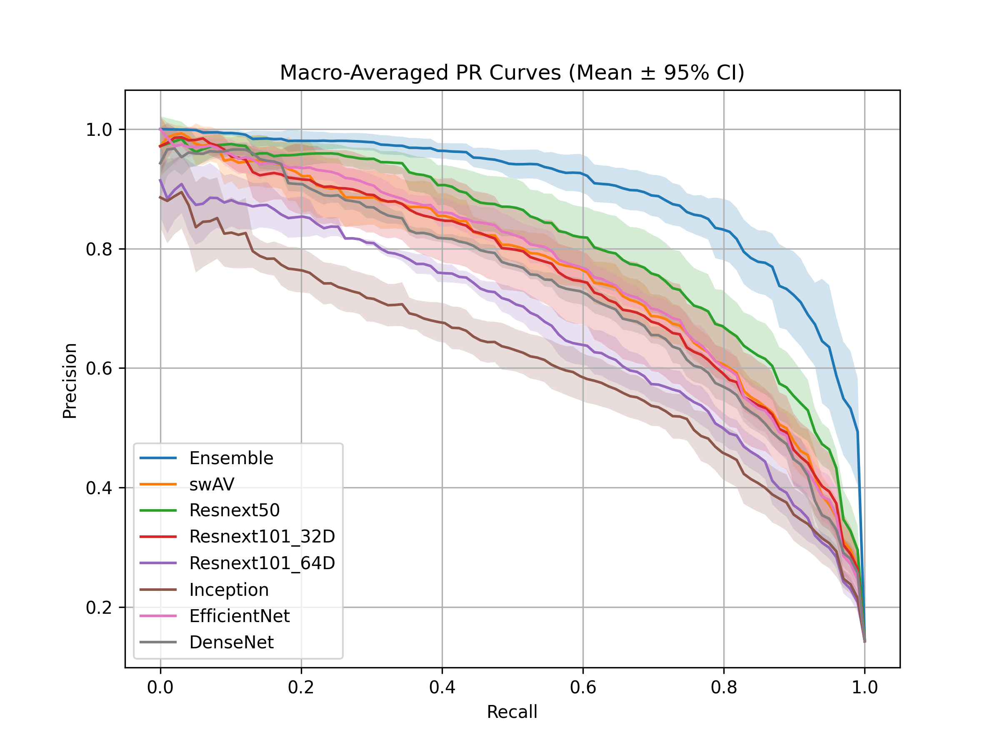
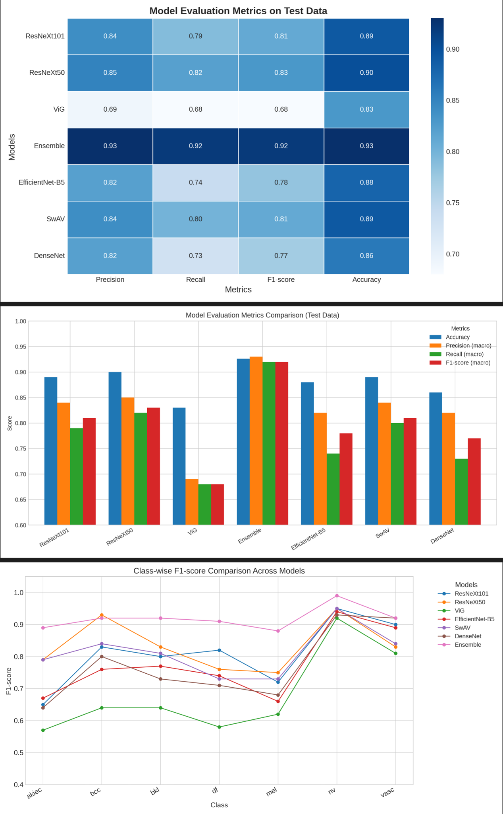

# Advancing Skin Lesion Classification with Cross-Validated Ensemble Learning

Seven deep-learning models and a soft voting ensemble were benchmarked for 7-class skin lesion classification on HAM10000. Every model is evaluated with **stratified 5-fold cross-validation** rather than a single train/test split.

The work started as a course project for CSE 4872 – Neural Network and Fuzzy System Lab (Spring 2022) and was later extended with the cross-validated evaluation.

## Why this matters

- Melanoma makes up only about 10% of skin cancers, but it causes about 80% of skin-cancer deaths.
- In 2020, Europe accounted for about half of all new melanoma cases worldwide. The United States recorded 196,060 new cases and 6,850 deaths.
- Invasive melanoma incidence has been rising since the mid-1970s, by about 2% per year between 2008 and 2017.
- Skin cancer treatment costs the United States an estimated $8.1 billion a year ($4.8 billion for non-melanoma cases and $3.3 billion for melanoma).

Early, accurate classification of skin lesions from dermoscopic images can help catch melanoma while it is still treatable.

<p align="center">
  
  
  <br/>
  <em>Age-standardized incidence of skin melanoma in 2020 (all sexes, all ages): worldwide (left) and in the 20 countries with the highest rates, per 100,000 people (right). Europe, North America and Oceania are the most affected regions. Figures reproduced from Nie et al. [1] under CC BY 4.0.</em>
</p>

## Research gap and objectives

Recent models report very high accuracy on HAM10000, for example 94.3% for a Vision Transformer (ViT) and 95% for a MetaFormer with focal self-attention. These results usually come from one fixed train/test split. Strong results on one split often drop under cross-validation, and few studies report cross-validated results for skin lesion classification at all.

This project therefore aims to:

1. Evaluate skin lesion classifiers with cross-validation, to get robust and unbiased performance estimates.
2. Show that the proposed ensemble performs consistently well across all folds, a better sign of generalization than a single train/test split.

## Dataset

[HAM10000](https://dataverse.harvard.edu/dataset.xhtml?persistentId=doi:10.7910/DVN/DBW86T) [2] contains 10,015 dermatoscopic images in seven classes. The images were collected in Austria and supplemented with images from the ISIC Archive from Australia and the United States.

<p align="center">
  
  <br/>
  <em>One example image per class from HAM10000.</em>
</p>

| Class | Description | Images | % |
|---|---|---:|---:|
| nv | Melanocytic nevi | 6,705 | 66.95 |
| mel | Melanoma | 1,113 | 11.11 |
| bkl | Benign keratosis-like lesions (solar lentigines, seborrheic keratoses, lichen-planus-like keratoses) | 1,099 | 10.97 |
| bcc | Basal cell carcinoma | 514 | 5.13 |
| akiec | Actinic keratoses and intraepithelial carcinoma / Bowen's disease | 327 | 3.27 |
| vasc | Vascular lesions (angiomas, angiokeratomas, pyogenic granulomas, hemorrhage) | 142 | 1.42 |
| df | Dermatofibroma | 115 | 1.15 |

## Method

<p align="center">
  
  <br/>
  <em>Workflow: data collection, preprocessing, classification with 5-fold cross-validation, and evaluation.</em>
</p>

- **Preprocessing:** every image is resized to the model's input size (table below) and normalized. Training images are augmented with random horizontal and vertical flips and a random perspective distortion (scale 0.2).
- **Folds:** `StratifiedKFold(n_splits=5, shuffle=True, random_state=42)` over all 10,015 images (about 8,012 train / 2,003 test per fold). Every notebook uses the same seed, so all models see identical folds.
- **Models:** all start from ImageNet-pretrained weights (SwAV from its self-supervised checkpoint), and the classifier head is replaced with a 7-class linear layer.

  | Model | Input size |
  |---|---|
  | SwAV (ResNet-50) | 600 × 600 |
  | Inception-v3 | 600 × 600 |
  | ResNeXt-50 (32×4d) | 450 × 450 |
  | ResNeXt-101 (64×4d) | 450 × 450 |
  | ResNeXt-101 (32×8d) | 224 × 224 |
  | EfficientNet-B5 | 224 × 224 |
  | DenseNet-121 | 224 × 224 |

- **Training:** AdamW (lr 1e-3, weight decay 0.05), cross-entropy loss. Each fold is trained in a separate run, and the best checkpoint is saved as `{accuracy}_fold_{k}_acc.pth`.
- **Ensemble:** the raw logits of **SwAV + ResNeXt-50 + ResNeXt-101 (32×8d) + ResNeXt-101 (64×4d)** are summed, and the predicted class is the argmax. Each model receives its own input size. This combination was chosen from the ablation runs in `ham10000-ensemble.ipynb`.


  ```mermaid
  flowchart LR
      IMG[Dermoscopic image] --> R1[Resize 600 × 600] --> M1[SwAV]
      IMG --> R2[Resize 450 × 450] --> M2[ResNeXt-50 32×4d]
      IMG --> R3[Resize 224 × 224] --> M3[ResNeXt-101 32×8d]
      IMG --> R4[Resize 450 × 450] --> M4[ResNeXt-101 64×4d]
      M1 -- 7 logits --> S((Σ))
      M2 -- 7 logits --> S
      M3 -- 7 logits --> S
      M4 -- 7 logits --> S
      S --> A[argmax] --> OUT[Predicted class:<br/>akiec · bcc · bkl · df · mel · nv · vasc]
  ```

- **Metrics:** accuracy, macro-F1, macro one-vs-rest ROC-AUC and macro PR-AUC on each test fold. Results are reported as mean ± SD over the 5 folds, with 95% confidence intervals in the `.txt` result files.

## Results (5-fold cross-validation)

| Model | Accuracy | Macro-F1 | ROC-AUC | PR-AUC |
|---|---|---|---|---|
| **Ensemble** | **0.8622 ± 0.0131** | **0.7324 ± 0.0492** | **0.9871 ± 0.0055** | **0.8955 ± 0.0318** |
| SwAV | 0.8398 ± 0.0100 | 0.6725 ± 0.0339 | 0.9641 ± 0.0051 | 0.7616 ± 0.0283 |
| EfficientNet-B5 | 0.8361 ± 0.0061 | 0.6903 ± 0.0270 | 0.9577 ± 0.0044 | 0.7652 ± 0.0235 |
| ResNeXt-50 (32×4d) | 0.8279 ± 0.0162 | 0.6633 ± 0.0469 | 0.9714 ± 0.0088 | 0.8118 ± 0.0352 |
| DenseNet-121 | 0.8210 ± 0.0093 | 0.6762 ± 0.0200 | 0.9579 ± 0.0026 | 0.7371 ± 0.0107 |
| ResNeXt-101 (32×8d) | 0.8201 ± 0.0283 | 0.6656 ± 0.0828 | 0.9575 ± 0.0112 | 0.7543 ± 0.0665 |
| Inception-v3 | 0.7979 ± 0.0148 | 0.5554 ± 0.0498 | 0.9348 ± 0.0114 | 0.6153 ± 0.0424 |
| ResNeXt-101 (64×4d) | 0.7730 ± 0.0135 | 0.5371 ± 0.0418 | 0.9445 ± 0.0055 | 0.6702 ± 0.0199 |

The ensemble beats every single model on all four metrics. The largest gains are in macro-F1 and PR-AUC, the metrics most sensitive to the minority classes.

<p align="center">
  
  
  <br/>
  <em>Macro-averaged ROC (left) and precision–recall (right) curves, mean ± 95% CI over the five folds.</em>
</p>

## Repository structure

```
├── 5-fold.ipynb                       # 5-fold training: Inception-v3, EfficientNet-B5, DenseNet-121 (switch model in the notebook)
├── swAV/swav-5fold.ipynb              # 5-fold training: SwAV
├── ResNeXt-50-32x4d/resnext50-32x4d-5fold.ipynb
├── ResNeXt-101-32x8d/resnext101-32x8d-5fold.ipynb
├── ResNeXt-101-64x4d/resnext101-64x4d.ipynb
├── ham10000-ensemble.ipynb            # loads fold checkpoints, builds the ensemble, computes all metrics and plots
│
├── y_true_folds_dict.pkl              # per-fold labels, predicted probabilities and predictions
├── y_prob_folds_dict.pkl              #   for every model and the ensemble
├── y_pred_folds_dict.pkl
├── accuracy.txt, macro_f1.txt, roc_auc.txt, pr_auc.txt   # results table above (with 95% CIs)
├── fold_classification_reports.txt    # per-fold classification reports
├── All_Models_Macro_ROC.png, All_Models_Macro_PR.png
│
├── <Model>/                           # per-model reports (.docx/.pdf) and per-fold ROC/PR figures (Folds/)
├── Ensemble/                          # ensemble reports, confusion matrices, ablation with EfficientNet
├── All Model Reports/                 # all per-model reports in one place
│
├── ham10000-*.ipynb                   # earlier single train/test split experiments (Spring 2022, see below)
└── vig-pytorch/                       # Vision GNN layers (gcn_lib) and training helpers (going_modular)
```

## Reproducing the results

The notebooks were written for Kaggle (2 × GPU, `nn.DataParallel`).

1. Add HAM10000 as a Kaggle dataset. The first cell merges its `train/` and `test/` folders into one `all_images/` folder before the folds are made.
2. Run each training notebook five times, setting `current_fold = 0 … 4`, and collect the five `*_fold_{k}_acc.pth` checkpoints per model.
3. Upload the checkpoints as a Kaggle dataset and point the `load_state_dict` paths in `ham10000-ensemble.ipynb` to them. Then run it once per fold to collect predictions and compute the metrics.

To recompute the metrics without any training, load the three `.pkl` files. The final cells of `ham10000-ensemble.ipynb` calculate every number in the results table from them.

Trained model weights are not included in this repository because of their size.

## Conclusion and future work

Under five-fold cross-validation on HAM10000, the ensemble outperformed every individual model on all four metrics.

- **Single dataset.** The evaluation used only HAM10000. Validation on other public datasets, such as BCN20000 (Spain) and PH² (Portugal), is needed to show that the results hold across different data distributions and acquisition settings.
- **Skin-tone bias.** HAM10000 and similar public dermatology datasets consist mostly of images from fair-skinned (predominantly Caucasian) people, so darker skin tones are underrepresented. This may reduce the models' robustness and fairness for underrepresented groups.
- **Next steps.** Future work should use larger, more diverse datasets covering a broader range of skin tones and ethnic backgrounds, to build fairer and more clinically reliable classifiers.

## Earlier single-split experiments (Spring 2022)

The `ham10000-*.ipynb` notebooks come from the original course project. They use one fixed train/test split (8,017 / 1,998 images) instead of cross-validation. That project also tested Vision GNN (ViG), ViT and MaxViT, and ran an ablation study on larger ensembles. On that split the ensemble reached about 93% accuracy. These numbers come from one split, so they are **not comparable** with the cross-validated results above.

<p align="center">
  
  <br/>
  <em>Single train/test split results from the Spring 2022 project.</em>
</p>

**Frameworks/Tools:** PyTorch, torchvision, timm, scikit-learn, Matplotlib, Plotly, Weights & Biases, OpenCV.

## References

1. Y. Nie, P. Sommella, M. Carratù, M. Ferro, M. O'Nils and J. Lundgren, "Recent Advances in Diagnosis of Skin Lesions Using Dermoscopic Images Based on Deep Learning," *IEEE Access*, vol. 10, pp. 95716–95747, 2022, doi: [10.1109/ACCESS.2022.3199613](https://doi.org/10.1109/ACCESS.2022.3199613).
2. P. Tschandl, C. Rosendahl and H. Kittler, "The HAM10000 dataset, a large collection of multi-source dermatoscopic images of common pigmented skin lesions," *Scientific Data*, vol. 5, 180161, 2018, doi: [10.1038/sdata.2018.161](https://doi.org/10.1038/sdata.2018.161).
